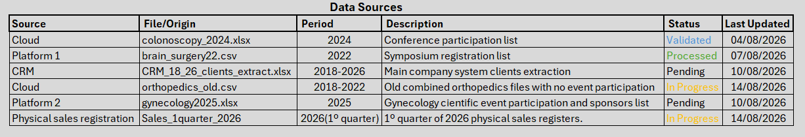
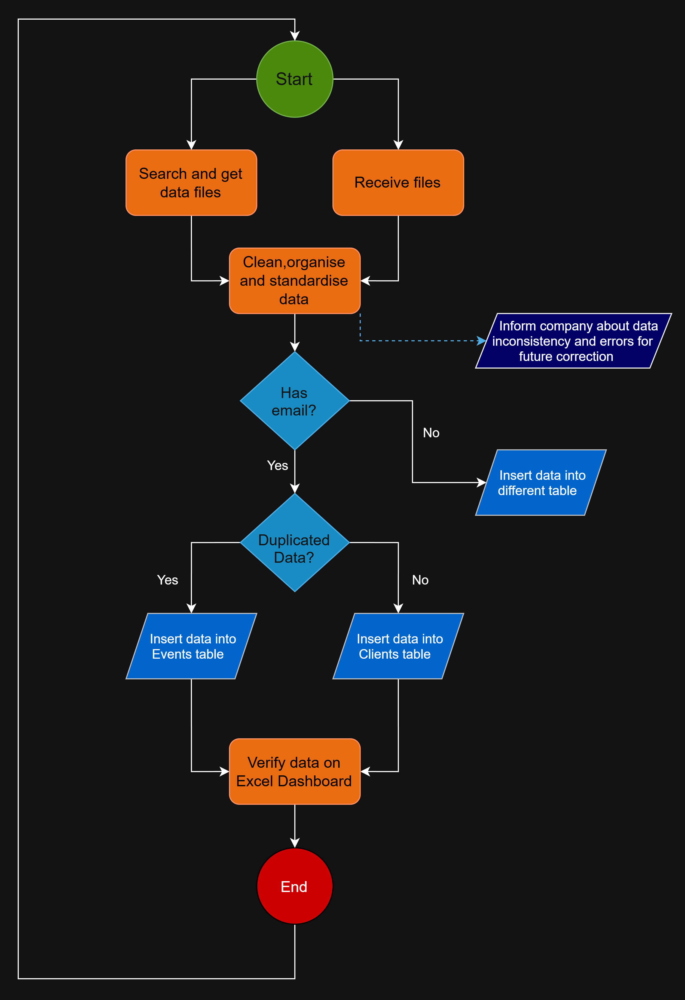
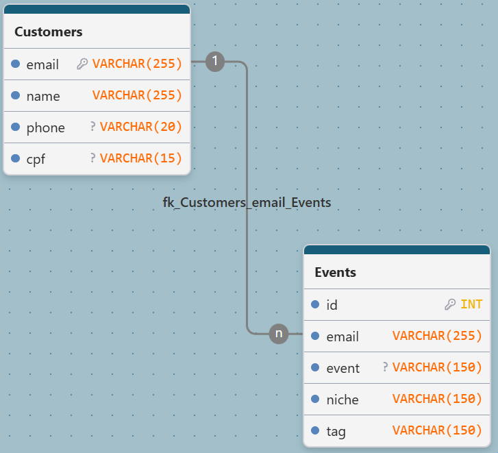
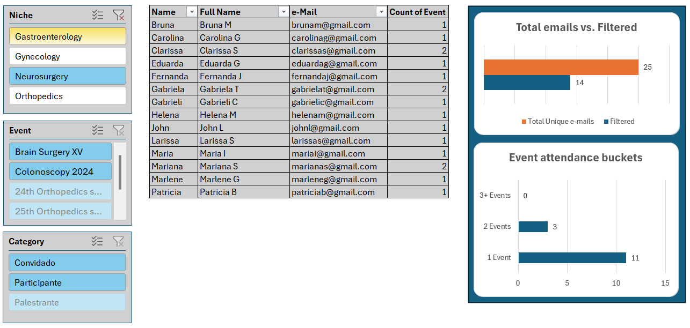
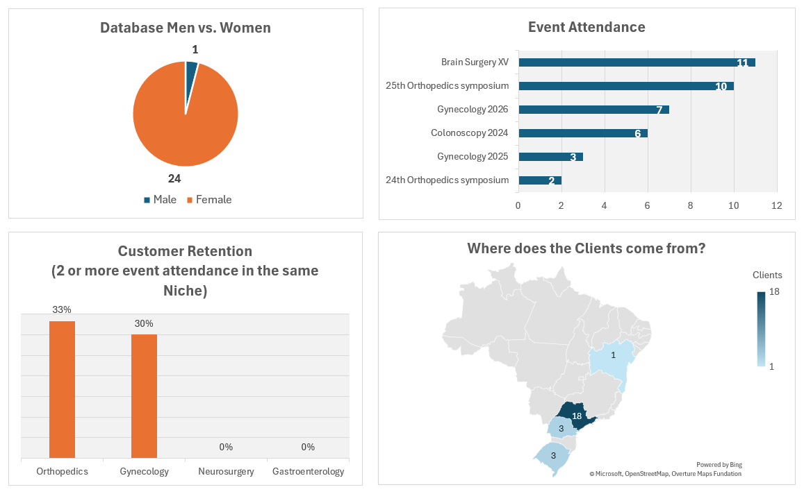

# Customer & Scientific Event Data Centralization

## Introduction

**Project in development 🛠️(Start date:July/2026 - Estimated conclusion: April/2027)**

This project is being developed in partnership with a company to centralize, standardize and organize customer participation data from scientific events. Also develop and link a PowerBI file to excel and help visualize important business insights.

In accordance with the LGPD (Brazilian General Data Protection Law), the files and information of this project will be modified to protect the company and its clients data.

&nbsp;
## 📌 Project Workflow

**Business Problem → Data → Transformation → Data Model → Analysis → Insights**

The project follows an end-to-end data analytics workflow, from
understanding the business problem to delivering actionable insights
through an excel database and simple dashboard and also a more complete Power BI dashboard.

&nbsp;
## 📊 Project Overview

**Business Problem**

Noticing the lack of a structured database and realizing that the company could not easily access important insights about its events/conferences participations nor quickly gather customers information for marketing purposes, I proposed this project to the company's CEO.

**Objective**

This initiative aims to consolidate information currently distributed across different Excel files and sources, creating a structured database in excel that can be directly connected to Power BI for business analysis and management reporting.

**Who would benefit the most from this project**

This project was created with the main objective of being easily usable and highly helpful for the CEO and the Business Partners.

**Main Questions Answered**

- How many customers/clients valuable and usable data the company holds at the moment.
- Customers retention in the same event or the same niche as previouly attented.
- The usage of the new database customers data for improving sales and event attendance.
- Main target of each niche and event, easily accesable through Dashboard in Excel and BI.

&nbsp;
## 🗂️ Project Structure

```
excel-bi-database-project/
│
├── documentation/
│   ├── data_model.png
│   ├── process_flow.png
│   └── data_dictionary.xlsx
│
├── excel/
│   └── sample_database_cleaning.xlsx
│
├── powerbi/
│   └── dashboard_demo.pbix
│
├── screenshots/
│   └──
│
├── README_PT.md
└── README.md
```

&nbsp;
## 📊 Dataset



**Explanations**: 

- Where the data comes from

    - The data come from differente sources like Cloud, CRM, Marketing CRM and also photos from physical sales books.

- What each file represents

    - name_of_event/old.xlsx -> normally represents the complete registration or participation data of the event.

    - CRM_extract.xlsx -> directly extracted from the company CRM, containing a huge amount of data, partitioned by the requested period.

    - files.csv -> includes only a few field like name and email.

    - sales or participation_1_quarter.png -> sales/participation photo recorded physical by staff.

- Data volume  
    - In this project the data volume expectation is about 200 files and more than 100k unique clients mailing.

- Limitations  
    - There are some limitations in the file gathering part of this project, which includes:  
        - Decentralization, missing values, unusable data and email missing values files.

&nbsp;
## 🔄 Data Process

Get/Receive data files  
↓  
Excel Data Cleaning  
↓  
Data Model  
↓  
Excel Dashboard / Insights  
↓  
Power BI  
↓  
BI Dashboards / Insights  

&nbsp;


&nbsp;

## 🧹 Data Preparation

**Main transformation steps:**

- Removed duplicates and unnecessary fields  

- Added requested fields

- Standardized Names, CPF/CNPJ, e-mail, phones, birthdate, CEP and City

- Corrected data types and alignment issues

- Handled missing values

- Loaded the cleaned data into the database

- Created DAX measures to get better insights

- Developed Excel Dashboard for simple extractions  

&nbsp;

## 🗃️ Data Model

In this project we decided to use email as the main relationship field as we can have duplicated names,phones and cpf but no duplicated emails. Considering a customer changing email, we would create a new unique client with the new email as requested by the company.  



Since we have multiple columns (+20) on the Database, this data model is just a sample to explain the relationship used.

&nbsp;

## 📈 Excel Dashboard

The idea of this Dashboard is being able to export a mailing on demand but at the same time get some quick insights about the customer and event attendance.



### Key KPIs
- Total emails in Database  
- Event Attendance Buckets

### Main Visualizations
- Gender Breakdown  
    - A pie chart illustrating the gender ratio across the database, showing a heavy skew toward female clients (24 female vs. 1 male).
- Attendance per Event  
    - A horizontal bar chart ranking the attendance per event.
- Customer Retention Rate  
    - A bar chart showing client retention (defined as attending 2 or more events in the same niche), highest in Orthopedics (33%) followed closely by Gynecology (30%).
- Geographic Distribution Map  
    - A choropleth map of Brazil highlighting client concentration by state, with the vast majority residing in São Paulo (18 clients).

&nbsp;


&nbsp;
### 🔎 Excel Insights

 With the data currently loaded into the database, I discovered the following insights:

 - The vast majority of clients are women  
 - 25th Orthopedics Symposium and Gynecology 2026 saw a considerable increase in attendance compared to their previous editions.
 - Orthopedics and Gynecology demonstrate high customer retention, with roughly 1 in 3 clients returning for another event within the same specialty.
 - Over half of all clients are based in the state of São Paulo (18), followed by the South Region of Brazil (PR, SC, RS).

## 📈 Power BI Dashboard
*Under Development🛠️*
### 🔎 Power BI Insights
*Under Development🛠️*

## 🛠️ Tools & Technologies

- Excel
- Power Query
- Power BI
- DAX
- Git / GitHub

## 💡 Skills Demonstrated
- Data cleaning  
- Data transformation  
- Data modeling  
- DAX (Measures)
- Excel  
- Power BI  
- Data visualization  
- Business analysis

## 🚀 How to Use

1. Clone/Download
2. Open excel sample_database
3. Filter by niche, event and category
4. Explore the dashboard
5. Get the insights as desired

## 📌 Limitations & Future Improvements

- Connect excel file to Power BI
- Add automated data refresh
- Add more historical data
- Implement BI Dashboards
- Publish the dashboard to Power BI Service

&nbsp;  
👤 Author

Ruan Oliveira

[[LinkedIn](https://www.linkedin.com/in/ruan-oliveira-200b12166/)] | [[GitHub](https://github.com/ruanxmelo)]


