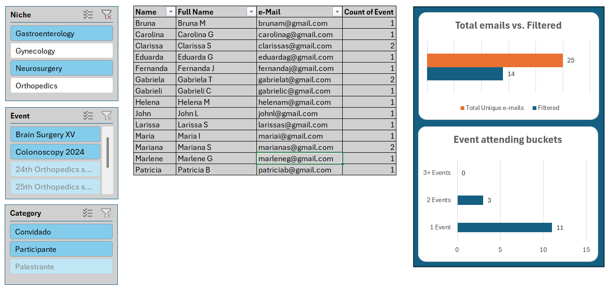
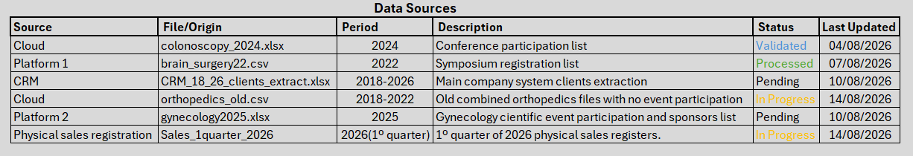

# Centralização de dados de clientes e eventos científicos

## Introdução

**Projeto em andamento 🛠️ (Inicio:Julho/2026 - Expectativa de finalização: Abril/2026)**



Esse projeto está sendo desenvolvido em parceria com uma empresa com o objetivo de centralizar, tratar e organizar dados de clientes e suas participações em eventos científicos. Também desenvolver e conectar essa base de dados Excel ao PowerBI, ajudando a visualizar insights importantes de negócio.

Em conformidade com a LGPD, os arquivos e informações aqui descritas, serão modificadas/simuladas protegendo os dados sensíveis da empresa e clientes.

&nbsp;
## 📌 Project Workflow

**Problema de negócios → Dados → Limpeza/Padronização → Data Model → Análise de dados → Insights**

Esse projeto segue um fluxo de trabalho de análise de dados de ponta a ponta, desde entender o problema de negócio até entregar insights acionáveis através de uma base de dados e dashboard simples no Excel e futuramente dashboards mais completos no PowerBI.

&nbsp;
## 📊 Project Overview

**Problema de Negócios**

Ao notar a falta de uma base de dados estruturada e perceber que a empresa não conseguia acessar importantes insights sobre seus eventos/conferências facilmente nem rapidamente coletar informações de seus clientes para ativações de marketing, Eu propus esse projeto ao CEO da empresa parceira.

**Objetivo**

Essa iniciativa visa consolidar informações atualmente distribuídas através de diferentes arquivos Excel e também outras fontes, criando uma base de dados estruturada que poderá ser diretamente conectada ao PowerBI para análises de negócios e relatórios gerenciais.

**Quem se beneficiará desse projeto**

Esse projeto foi desenvolvido para ser de fácil uso e proporcionar utilidade prática para o CEO e seus sócios.

**Principais questões respondidas**

- Quantidade de dados valiosos e acionáveis a empresa possui no momento.
- Retenção de clientes em eventos ou do mesmo nicho que participou previamente.
- O real uso dessa nova base de dados para aumentar vendas e a participação dos eventos.
- O público alvo dos eventos e seus nichos, facilmente acessáveis através do dashboard no Excel e BI.

&nbsp;
## 🗂️ Estrutura do Projeto

```
excel-bi-database-project/
│
├── documentation/
│   ├── data_model.png
│   ├── process_flow.png
│   └── data_dictionary.xlsx
│
├── excel/
│   └── sample_database_cleaning.xlsx
│
├── powerbi/
│   └── dashboard_demo.pbix
│
├── screenshots/
│   └──
│
├── README_PT.md
└── README.md
```

&nbsp;
## 📊 Dataset



**Contexto dos Dados**

- De onde os dados são extraidos?

    - Os dados são extraidos de diferentes fontes, como Nuvem, CRM, CRM de Marketing e também arquivos fisicos registrados manualmente e depois digitalizados.

- O quê cada arquivo representa

    - name_of_event/old.xlsx -> Traz os dados completos de registro e participação dos clientes no evento mencionado.

    - CRM_extract.xlsx -> Arquivos extraido diretamente do CRM da empresa, contendo um grande volume de dados, particionado pelo periodo solicitado.

    - files.csv -> Arquivos mais antigos que geralmente incluem poucas informações, como nome e email.

    - sales or participation_1_quarter.png -> Venda ou participação dos eventos que foram digitalizadas de arquivos fisicos da equipe.

- Volume de Dados 
    - Nesse projeto, a expectativa de volume de dados é aproximadamente 200 arquivos e mais de 100k de emails únicos de clientes.

- Limitações  
    - Nesse projeto há algumas limitações na parte de coleta dos arquivos, incluindo:  
        - Decentralização, falta de dados, dados inutilizáveis e arquivos sem coluna de email.